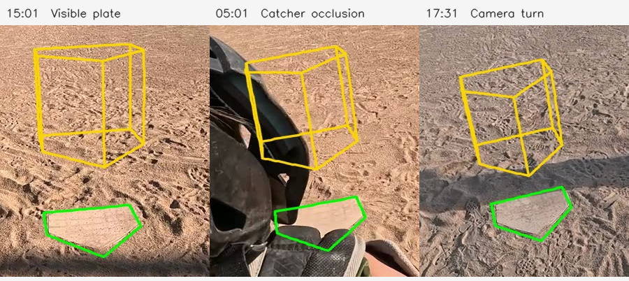
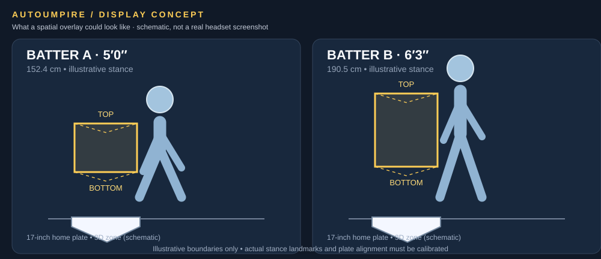

# AutoUmpire

**A hardware-agnostic, augmented strike-zone *visualization* prototype for umpire augmentation.**.  Better than Angel Hernandez.

## Real-game checkpoint — October 25, 2026

The experimental field-map localizer can keep a 3D zone anchored while the catcher obscures the plate. It now matches each query frame against the whole map using the original COLMAP features, without knowing where the query occurs in the reference video.



*Actual output crops from UmpireCentral footage supplied with permission for project development. Yellow is an illustrative zone from 0.40 to 0.80 m above the plate; green is the projected plate footprint. The crops exclude identifiable people. These are rendered estimates, not independent ground truth.*

Using the **same fixed map**, built from approximately 13:00–13:30 of one recording, the revised localizer improves five separate, approximately four-second windows:

| Source time | Before: overlay enabled | Current: overlay enabled |
|---|---:|---:|
| 02:00 | 0.0% | 67.5% |
| 05:00 | 0.0% | 99.2% |
| 10:00 | 0.0% | 99.2% |
| 15:00 | 47.3% | 97.5% |
| 17:30 | 0.0% | 98.3% |

Together, these windows contain 1,196 frames: overlay acceptance rises from **9.4% to 92.3%**. The original 30-second benchmark improves from 90.1% to 96.0%; an adjacent 30-second query excluded from the map improves from 92.3% to 95.2%. The display confidence and continuity thresholds are unchanged.

**Scope:** these are exploratory development samples from one edited recording, not complete-game or multi-game coverage. They were used to diagnose failures and select matching settings, so they are not an untouched test set. The 02:00 window remains intermittent. Four approximate visible-plate checks differ from manual corner markings by 6.7–8.0 pixels RMS; that does not establish metric accuracy. Processing remains offline, and zone heights are not measured from the batter.

The checkpoint passes **47 local tests**: 24 existing Python tests, eight field-map regressions, 13 JavaScript unit tests, and two emulated AR tests. The production build passes; physical-device behavior remains unverified.

- [Checkpoint evidence, methods, and limitations](docs/experiments/field-map-relocalization.md)
- [Run the independent-video localizer](experiments/field_map/README.md#localize-a-separate-recording)
- [Evaluate a larger footage collection](docs/footage-validation.md)

## Simulator concept



*Concept artwork, not a device screenshot.* The two different-height batters demonstrate how the manually calibrated **top and bottom** of the strike-zone volume change with the batter. The zone is a **pentagonal 3D prism** above actual 17-inch home plate geometry—not a flat rectangle pasted on the camera.

## What you can run today

- Desktop Three.js simulator with orbit/zoom, true-scale plate, 3D zone edges and translucent top/bottom faces.
- Switch between illustrative **5′0″** and **6′3″** batter silhouettes. Drag sliders to override the strike-zone elevations individually.
- **Experimental WebXR** manual AR placement using hit-test. Tap the plate's back tip, then the midpoint of its front edge; the two taps set position and heading, and a span check rejects inconsistent placement. This only works on supported devices/browsers via HTTPS; it does **not** detect the plate or verify field accuracy.
- Separate pure geometry and projection modules so input can later come from a headset, camera, GoPro, or replay file.
- Calibrated marker tracking for recorded video and a separate experimental markerless field-map localizer with an offline overlay renderer.

### Run

```bash
npm install
npm test
npm run dev
```

`npm run test:ar` drives the real AR placement flow (Start AR → two taps → heading and span check) against an emulated WebXR headset ([IWER](https://www.npmjs.com/package/iwer)) in headless Chromium. Run `npx playwright install chromium` once, or set `CHROMIUM_PATH`. It cannot test the AR control-panel overlay, real tracking or rendering. iOS Safari has no WebXR AR, so test on hardware with an Android ARCore phone or a Quest.

Visit the URL printed by Vite. Use the controls on the left. On an appropriate WebXR AR device, serve over HTTPS and use the **Start AR** control when available.

### GoPro / recorded video (secondary objective)

Recorded video goes through the calibrated tracker (`tools/track_video.py`, see Phase 2 below) and is reviewed in `review.html`. The tracker logs each frame's real container timestamp, so variable-frame-rate phone video lines up correctly. The earlier `overlay_video.py` helper was removed: it ignored lens distortion, which is large on GoPro wide modes.

For markerless footage, use [`experiments/field_map/`](experiments/field_map/README.md). Its COLMAP camera models and `localized.json` use a separate renderer, `render_overlay.py`; they are not inputs to `review.html`. Keep a reference map fixed and write each independent query to its own output directory.

## Important limitations

1. These strike-zone boundaries are **illustrative**, not batter landmarks identified by CV or measurements from a league-certified rulebook.
2. WebXR hit-test only finds a physical surface point. **It does not measure home plate, determine heading, or validate anchor drift.** Headset sensor and browser behavior vary.
3. **Do not use this prototype to adjudicate live pitches.** A visually convincing but misregistered box can be worse than no overlay, especially at 90+ mph.
4. GoPro monocular video requires camera calibration plus a 6DoF camera trajectory; a 2D homography on its own is not sufficient for accurate 3D elevation.

## Project map

| Area | Role |
|---|---|
| `src/geometry.js` | Pure plate and strike-zone geometry, SI units |
| `src/projection.js` | Input-independent calibrated 3D-to-image projection |
| `src/main.js` | Three.js desktop rendering and experimental WebXR placement |
| `tools/track_video.py` | Marker tracking on recorded or live video; per-frame poses and timestamps |
| `tests/` | Unit tests for dimensions, geometry, error cases and projection |
| `docs/strike-zone-preview.svg` | Concept image showing two batter heights |
| `docs/architecture.md` | Calibration contract, validation and next milestones |
| `experiments/field_map/` | Offline markerless localization against a fixed field map ([current checkpoint](docs/experiments/field-map-relocalization.md)) |
| `docs/footage-validation.md` | Corpus organization, independent evaluation, annotations, and reporting |

Use the [footage-validation guide](docs/footage-validation.md) to assess additional games before drawing broader accuracy or coverage conclusions. Batter-specific zone measurement and real-device tracking remain unverified.

Uses [Three.js](https://threejs.org/) and browser [WebXR hit-testing](https://developer.mozilla.org/en-US/docs/Web/API/XRSession/requestHitTestSource). Requires hardware support; experimental APIs are not universal.

## Phase 2 — Camera calibration, plate registration, and batter stance proposals

**Now available (experimental):**
- Calibrate real cameras with chessboard images via `tools/calibrate_camera.py`.
- Generate a physical ArUco reference tag; measure its rigid offset from home plate.
- Plan and use a **multi-marker layout** (4 recommended), fit jointly, with displaced-marker rejection; `tools/simulate_registration.py` predicts overlay error for a layout and viewpoint.
- Detect the marker and solve a **per-frame 6DoF** world-to-camera transform, using calibrated intrinsics, lens distortion, and physical plausibility checks. Lost tag, insufficient pixels, high reprojection error, or pose discontinuity means **hide the overlay**.
- Optional `--allow-plate-contour` white pentagon detector for unobstructed benchmark footage; **not a production tracker**.
- Manually calibrated batter top/bottom bounds; optional **MediaPipe pose-landmark proposals** within a supplied batter ROI, with 8-frame stability lock and an explicit acceptance switch. 2D body ratios are **not metric ground truth** or league-approved strike-zone measurements.
- `tools/track_video.py` takes recorded video or a webcam source and produces accepted pose metadata plus optional annotated MP4.
- `review.html` browser tool takes original video plus the generated tracking JSON and renders only accepted camera poses. Vite builds both the simulator and review page.

See **[field calibration and runbook](docs/field-calibration.md)** for measured inputs and commands.

```bash
python -m pip install -r requirements-cv.txt
python tools/generate_marker.py --id 0 1 2 3 --output marker-{id}.png
# Measure the markers and camera, then create field.json from docs/field-calibration.md
python tools/track_video.py --input practice.mp4 --config field.json \
  --output-video review.mp4 --output-json tracking.json
```

Unit and synthetic-video tests verify marker detection, physical 6DoF reconstruction, and fail-closed marker loss. **Field accuracy, wearable registration, and batter landmark agreement remain unverified.** Do not use for live pitch adjudication.
