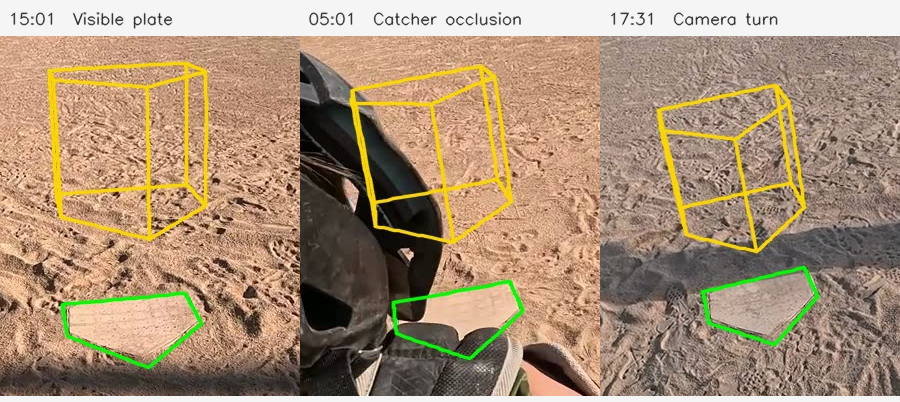

# Field-map localization checkpoint: independent real-game footage

**Recorded:** October 25, 2026. **Status:** improved offline localization on one recording; incomplete coverage and unverified absolute accuracy.

## Input and separation

The project owner supplied `umpire.mp4`, an 18-minute edited game recording, and confirmed permission from UmpireCentral to use it for project development. The recording contains hard cuts and animated title graphics. Query frames were resized from 3840×2160 to 1280×720 without cropping.

The reference map comes from `seg1.mp4`, approximately source 13:00–13:30. Four hand-annotated plate views define its anchor and scale. Five query windows at 02:00, 05:00, 10:00, 15:00, and 17:30 are excluded from both map construction and anchoring. An adjacent 30-second query, approximately source 12:30–13:00, is also excluded.

These are different parts of the same recording, with different batters, viewpoints, and lighting. They do not test a different field, camera, or day. The larger footage collection has not yet been evaluated.

The clips are **exploratory development samples**: they were inspected during debugging, including comparison of 0.8 and 0.9 descriptor ratios on the 02:00 window. Exclusion from mapping and anchoring is distinct from exclusion from parameter selection. These results therefore do not constitute an untouched test-set evaluation; reserve other recordings before tuning against the larger collection.

## What changed

The original localizer chose four reference frames by timestamp. For independent queries before or after the reference segment, that reduces to repeatedly searching the first or last four map frames. Recomputing OpenCV features and associating them with nearby COLMAP observations also left more than half the map's landmarks unused in the diagnostic.

The original CLI could not directly accept an independent query recording. For the baseline, a temporary adapter supplied known source timestamps to the original initialization and localization functions. Its matching, pose estimation, and four-reference selection were unchanged. The current CLI accepts the query directly and needs no source-timestamp adapter.

The revised implementation:

- Reads the original COLMAP RootSIFT descriptors using exact observation indices and uses the same extractor for query frames.
- Searches all mapped landmarks with OpenCV FLANN, without pairing reference and query timestamps.
- Compares descriptor matches against the nearest **different 3D landmark**. Repeated views of one landmark are supporting observations, not competing identities. Each landmark contributes at most one pose correspondence.
- Uses a 0.9 descriptor ratio instead of 0.8, admitting additional candidates to the unchanged 4-pixel geometric RANSAC check.
- Reads the feature database through standard-library SQLite in read-only mode. COLMAP's database opener initializes the schema and attempted writes during read-only and concurrent use; the reader validates its pinned schema, image names, dimensions, descriptor type, and observation coordinates.
- Accepts a separate query video and result directory; the renderer reads that query's poses and writes fresh sidecars beside its output.

There are no new dependencies. Feature extraction, nearest-neighbor search, and pose estimation use the existing COLMAP and OpenCV dependencies. The current [runbook](../../experiments/field_map/README.md) describes setup and commands.

## Results with the original map held fixed

Each distant window is approximately four seconds. Differences in frame counts come from the source timestamps and extraction boundaries.

| Source start | Frames | Before enabled | Current enabled | Current median / p95 slip |
|---|---:|---:|---:|---:|
| 02:00 | 240 | 0 / 240 (0.0%) | 162 / 240 (67.5%) | 0.17 / 0.28 px |
| 05:00 | 239 | 0 / 239 (0.0%) | 237 / 239 (99.2%) | 0.12 / 0.25 px |
| 10:00 | 239 | 0 / 239 (0.0%) | 237 / 239 (99.2%) | 0.09 / 0.12 px |
| 15:00 | 239 | 113 / 239 (47.3%) | 233 / 239 (97.5%) | 0.10 / 0.20 px |
| 17:30 | 239 | 0 / 239 (0.0%) | 235 / 239 (98.3%) | 0.11 / 0.16 px |
| **Combined sample** | **1,196** | **113 / 1,196 (9.4%)** | **1,104 / 1,196 (92.3%)** | — |

These percentages count frames that pass the display gates, not frames with independently verified registration. A projected plate or part of the zone can be outside the image while the camera looks away.

The 02:00 window is still weak: 65 frames have too few inliers and 13 are acquiring. Its enabled interval is query frames 24–185, approximately +0.40 to +3.09 seconds.

The longer regressions also improve:

| Clip | Frames | Before enabled | Current enabled |
|---|---:|---:|---:|
| Original benchmark, used to build the map | 1,797 | 1,619 (90.1%) | 1,726 (96.0%) |
| Adjacent query excluded from the map | 1,799 | 1,661 (92.3%) | 1,712 (95.2%) |

The original benchmark is an in-sample check. Its higher coverage is not independent evidence of generalization.

## Actual output examples

The left crop shows a visible plate at source 15:01; the middle shows the projected zone and plate with catcher occlusion at 05:01; the right shows a changed camera orientation at 17:31. Yellow is the rendered 0.40–0.80 m zone, and green is the projected plate. These bounds are illustrative inputs, not measurements of the batters.

The image uses unscaled crops of query frame 60 from the respective 59.94 fps windows. Crop bounds in the 1280×720 output are `(600,230)–(900,590)`, `(620,270)–(920,630)`, and `(460,240)–(760,600)`. The crops omit identifiable people. Full source footage, full-frame keyframes, review videos, maps, and run artifacts stay outside the repository.

## Confidence and accuracy

The renderer still requires at least 60 inliers, median supporting-map track length 5, continuity within 10.5 m/s and 750°/s, and three consistent frames to acquire or reacquire. Those display thresholds were not relaxed.

Four previously marked visible-plate frames in the adjacent query give these approximate corner differences:

| Query time | Corner RMS | Largest corner difference |
|---|---:|---:|
| 00:00 | 7.7 px | 15.4 px |
| 00:08 | 7.0 px | 12.6 px |
| 00:12 | 6.7 px | 11.6 px |
| 00:16 | 8.0 px | 10.5 px |

The manual readings have approximately 4–6 pixels of uncertainty. Four checks are not a representative accuracy study, and they provide no independent metric ground truth. Anchor consistency is also not an independent accuracy measurement.

Slip measures motion consistency against optical flow, not absolute placement. Cuts and moving graphics can produce large outliers: the 05:00 window has a 36.70-pixel maximum at a cut, and the adjacent query has a 29.44-pixel maximum around an animated graphic. Report these alongside medians rather than treating smoothness as proof of accuracy.

An additional-reference experiment increased inlier counts but reconstructed cameras kilometers from the field; the continuity gate rejected its query results. That invalid map and its extension utility are excluded from this checkpoint. Reference expansion needs geometric validation, not an inlier-count improvement alone.

## Verification and practical limits

Local verification passes 47 tests: 24 existing Python tests, eight synthetic field-map regressions, 13 JavaScript unit tests, and two emulated AR tests. The production build and whitespace checks pass. The new field-map suite is configured in CI; remote CI was not run for this local checkpoint.

The synthetic tests cover independent queries without reference images or timing, repeated landmark observations, descriptor ambiguity, unique correspondences, unrelated and blank imagery, read-only databases, incompatible observation rows, and fresh per-query output. The AR test setup now waits for the emulated controller before driving it.

All three local review videos decoded fully with the expected frame counts. Independent code review found no remaining actionable defects in the change.

Processing remains offline. Each worker owns a map index, so concurrent queries can exceed available memory. Evaluation wall times include contention and paused runs and should not be used as steady-state throughput measurements.

This checkpoint does not establish complete-game coverage, performance across different games, metric zone accuracy, batter-specific height accuracy, or real-time wearable operation. Use the [footage-validation guide](../footage-validation.md) for evaluating a larger collection.
